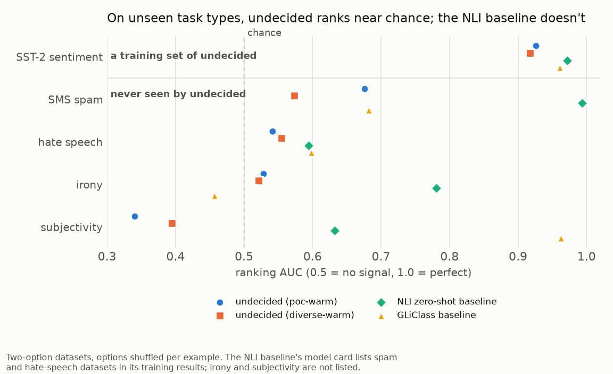
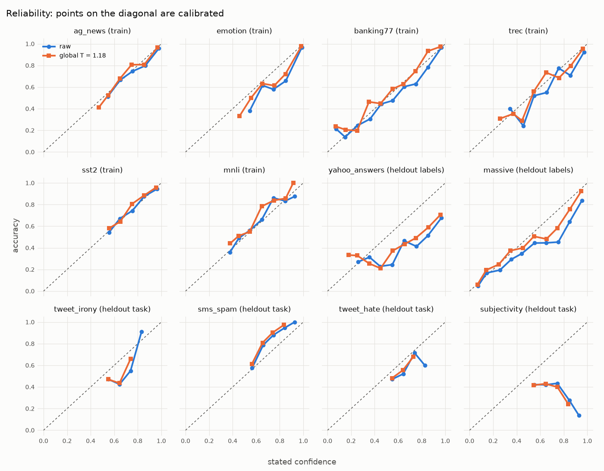
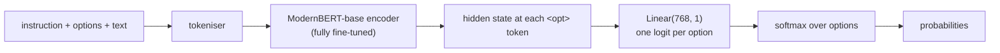

# undecided

A small, open reproduction of the idea behind Jev: a classifier that never generates text and
instead returns probabilities over options you choose at request time. This version is built on
[ModernBERT-base](https://huggingface.co/answerdotai/ModernBERT-base) (149M parameters) with a
linear head that scores each option, and it was fine-tuned on a laptop GPU.

> **Status:** complete. This is a learning project, closed on 2026-10-14 after a last day of
> experiments. The model handles new labels on familiar kinds of task and answers in about 12 ms
> at 10 options on a laptop. It ignores the instruction and fails on kinds of task it never
> trained on. An existing zero-shot model with the same backbone, trained on far more data, does
> much better, at up to 5 times the latency on the laptop GPU (more on CPU), including on two task
> types it apparently never saw. The day-by-day record is in the [implementation plan](plans/undecided.md).
>
> Not affiliated with TypeSafe. "Jev" refers to their product and is used here only to
> describe the behaviour being reproduced.



## What Jev does

According to the public write-ups ([MindStudio](https://www.mindstudio.ai/blog/jev-vs-classic-classifiers-benchmark),
[Towards Data Science](https://towardsdatascience.com/jev-vs-llms-when-ai-moves-from-generation-to-decision-making/),
[XenoSpectrum](https://xenospectrum.com/en/jev-typesafe-bert-classifier-decomposition/)):

- TypeSafe calls it a "System One" model. It returns probabilities over the options you define
  and does not produce text or a chain of thought.
- It answers in a single pass, in 70 to 500 ms.
- It is trained with reinforcement learning for calibrated decisions (RL-CD), meant to make a
  90% confidence score correspond to 90% real accuracy.
- In published comparisons, locally trained classifiers win on raw accuracy for a fixed task,
  and Jev wins on zero-shot flexibility and on instructions that change at runtime.

The calibration claim is disputed. [Alex Molas argues](https://www.alexmolas.com/2026/09/23/jev-cant-be-calibrated.html)
that calibration depends on the data distribution, which a zero-shot model never sees, so
Jev's probabilities can't be calibrated for your data.

## The idea

The target is Jev's interface. Its training recipe and architecture stay out of scope, and
what gets reproduced is the contract:

```text
input:   text, a list of options, an optional instruction
output:  one probability per option, summing to 1
cost:    one forward pass of a small encoder
```

The case study set out to answer five questions:

1. **How much zero-shot behaviour does a 149M encoder fine-tuned on public classification
   datasets get?** It handles new labels for kinds of task it trained on, and nothing beyond
   that. An existing zero-shot model with the same backbone, trained on far more data, does
   better on both.
2. **How well does it handle labels and task types it never saw?** Labels well, task types not
   at all. See [Findings](#findings).
3. **Are its probabilities calibrated?** On the training tasks, yes; on new data, no. One global
   temperature doesn't fix new data; a temperature fitted on 200 labelled examples per dataset
   mostly does, as the Molas argument predicts.
4. **How fast is it, and how does latency grow with the number of options?** 12 ms at 10
   options, about 2.5 times the 2-option cost at 50 options. A one-pass-per-option baseline is
   4.8 times slower at 50 options.
5. **What does fine-tuning the encoder buy compared with training only the head?** Everything.
   With the encoder frozen the model stays at chance; LoRA adapters on 1% of the weights land in
   between.

## Findings

**One forward pass handles any set of options, and it is fast.** Packing the options into the
input and scoring each `<opt>` marker with a shared `Linear(768, 1)` gives a probability
distribution over the options of each request. On an M4 Pro GPU a request takes 9 ms with 2
options, 12 ms with 10 and 23 ms with 50, so 50 options cost 2.5 times what 2 do. The NLI
baseline, which runs one pass per option, takes 16, 26 and 110 ms. This part of Jev's contract is
easy to reproduce with a small encoder.

**Matching a text to a new label is a different skill from doing a new kind of task.** The model
learned to read label words: the final model scores 4.8 times chance on Yahoo Answers topics and
25 times chance on MASSIVE's 60 assistant intents, labels it never saw in training. It did not
learn to make a judgement it was never trained to make. Irony, spam, hate speech and
subjectivity all need a property of the text ("does it mean the opposite of what it says?"), and
on them its ranking is weak or worse than random (AUC 0.34 to 0.68, where 0.5 is a coin flip).
Subjectivity ranks below chance in every fully fine-tuned `undecided` model (AUC 0.34 to 0.40),
probably because SUBJ's "objective" sentences are plot summaries full of charged words ("villainous", "horrifying murders"), and the
model reads emotional vocabulary as opinion.

**The model ignores the instruction.** Removing the instruction, or swapping in another
dataset's, moves accuracy by at most 0.012 on the five single-text training datasets and the
new-label datasets
(TREC: 0.772, 0.762, 0.760). On irony, accuracy even rises without its instruction (0.478 to
0.597). SMS spam is the only dataset where the instruction carries signal (AUC 0.68 with it, 0.58
without). The likely reason, not tested: in the training data each task's instruction always
arrives with that task's label set, so the options already identify the task, and "Is this tweet
ironic?" has nothing to steer.

**An existing zero-shot model does what this one can't, though not a clean zero-shot test.**
[`ModernBERT-base-zeroshot-v2.0`](https://huggingface.co/MoritzLaurer/ModernBERT-base-zeroshot-v2.0),
the same backbone with one NLI pass per option, scores 0.645 on Yahoo and 0.701 on MASSIVE
(against 0.478 and 0.422), and SMS spam AUC 0.99. Its model card, under "Training results", lists
per-dataset scores for a mix that includes Yahoo topics, MASSIVE, banking77, emotion, AG News, a
spam dataset and two hate-speech datasets, so those numbers most likely come from training on
them. Irony and subjectivity are not in that list, and on them it still ranks far better than
`undecided` (AUC 0.78 and 0.63, against 0.53 and 0.34). That points the same way as everything
else here: a 149M encoder can handle unseen task types, and what this project lacks is breadth of
training data, not capacity. `undecided` is clearly ahead on two of its own training datasets,
emotion and TREC (it ties on AG News), and on speed.

**The encoder has to learn.** On the same data and schedule as `poc`, training only the head
(769 parameters, encoder frozen) stays at chance on every dataset: 0.230 mean accuracy on the
single-text training datasets, where chance is about 0.2. LoRA adapters (1.6M parameters, 1% of
the model) reach 0.474, and full fine-tuning 0.752. A linear head can't make an option interact
with the text by itself; that comparison happens inside the encoder. LoRA broke out of the slow
start about 400 steps later than full fine-tuning and was still improving when the schedule
ended, so the same budget probably undertrains it.

**One temperature can't calibrate new data; 200 labelled examples can.** On the training tasks
the final model is well calibrated (calibration error 0.02 to 0.08). On new data it drifts: on
Yahoo it is 72% sure on average and right 48% of the time. A global temperature (T = 1.18),
fitted on fresh samples of the training datasets, lowers the average calibration error on the six
held-out datasets only from 0.161 to 0.140. A temperature fitted on 200 labelled examples of each
held-out dataset brings it to 0.058. The fitted temperatures point in opposite directions (SMS
spam 0.55, Yahoo 2.31, hate speech 3.87), which is why no single value works. Subjectivity can't
be fixed at all: its ranking is inverted, and the fitted temperature runs into the search limit.

**Learning starts with word overlap between options and text.** Logging the loss per dataset
showed the order: in the first 1,000 steps the clear movers were banking77 and TREC, the
many-option intent and question-type tasks where label words appear in the text ("card arrival",
"my card hasn't arrived"), with emotion a distant third. AG News and SST-2 stayed at chance until
that skill existed. A mix that cut banking77 from 1 in 6 training examples to 1 in 13 stayed at
the loss of uniform guessing for 2,000 steps; the same mix trained from the `poc` checkpoint
learned immediately. The long flat start of the `poc` run was the same effect.

**Four more task types didn't help.** Ten task types, with a quarter of the single-text examples
(about 15% of all examples) asked as yes/no checks shaped like the unseen tasks ("ironic / not
ironic"), did not move unseen task AUC (0.51 against 0.52 for the control). The control, the same
amount of extra training on the original six tasks, did as well or better on every training task
and both new-label datasets, probably because the diverse mix gave each original task 3,000
examples instead of 5,000; the new-label gap, though, is within seed noise (see below).

**Option order changes the answer, and averaging orders helps many-option tasks.** The options
are part of the input, so their order changes the probabilities. Averaging the probabilities of 4
orders raises accuracy on banking77 from 0.642 to 0.669, TREC from 0.774 to 0.792 and MASSIVE
from 0.419 to 0.440 (against the mean single order), and lowers their calibration error, at 4
times the cost. With 2 to 6 options it changes accuracy by 0.01 at most. Single fixed orders can mislead: `poc`'s
spam AUC was 0.56 with the options always in the order "not spam, spam", and 0.65 with shuffled
orders.

**Accuracy misled on the unseen two-option tasks.** SMS spam at 0.839 looks fine until the
majority baseline (0.851) and macro-F1 (0.51) sit next to it. `diverse-warm`'s irony accuracy
rose from 0.446 to 0.614 while its ranking stayed at chance. For that reason the main results
tables give the majority baseline and macro-F1 or AUC for every two-option dataset.

**A second training seed moves the numbers by about as much as some of the gaps above.**
Repeating `poc-warm`'s step with training seed 1, on the same examples, gives 0.796 instead of
0.816 on the training tasks and 0.428 instead of 0.450 on the new labels; single many-option
datasets move more (banking77 by 0.072, MASSIVE by 0.045). So the gap between `poc-warm` and
`diverse-warm` on new labels (0.450 against 0.425) is within seed noise, and only the large
differences here are safe conclusions: the unseen-task failure, head only and LoRA against full
fine-tuning, and the baselines.

## Results

### The models

| Model | Starts from | Training | Steps | Time on the laptop |
|---|---|---|---|---|
| `poc` | ModernBERT-base | 6 datasets, 5,000 examples each, 2 epochs | 3,750 | 53 min |
| `poc-warm` (final) | `poc` | the same 6 datasets, 1 more epoch | 1,875 | 17 min |
| `poc-warm-seed1` | `poc` | as `poc-warm`, training seed 1 | 1,875 | 18 min |
| `diverse-warm` | `poc` | 10 datasets, 3,000 each, a quarter of the single-text examples (about 15% overall) asked as yes/no checks, 1 epoch | 1,875 | 17 min |
| `head-only` | ModernBERT-base | as `poc`, encoder and `<opt>` vector frozen | 3,750 | 7 min |
| `lora` | ModernBERT-base | as `poc`, rank-16 LoRA on the attention projections | 3,750 | 17 min |
| NLI baseline | | [`MoritzLaurer/ModernBERT-base-zeroshot-v2.0`](https://huggingface.co/MoritzLaurer/ModernBERT-base-zeroshot-v2.0), used as released | | |
| GLiClass baseline | | [`knowledgator/gliclass-modern-base-v2.0-init`](https://huggingface.co/knowledgator/gliclass-modern-base-v2.0-init), used as released | | |

`poc-warm` is the control for `diverse-warm`: same start, same number of steps, only the task mix
differs. It scored best among the `undecided` models, so it is the one the usage examples load,
though its lead over `diverse-warm` is partly within seed noise.

### Summary

Every dataset counts once in each average, whatever its size. "Training tasks" are the five
single-text datasets all `undecided` models trained on (MNLI is left out because the baselines
skip it). For the unseen task types the average accuracy is misleading (see
[per dataset](#per-dataset)), so the table gives macro-F1 and ranking AUC, where 0.5 means no
signal.

| Model | Training tasks, accuracy | New labels, accuracy | Unseen task types, macro-F1 | Unseen task types, AUC | Held-out calibration error |
|---|---|---|---|---|---|
| `poc` | 0.752 | 0.397 | 0.462 | 0.51 | 0.152 |
| `poc-warm` | **0.816** | 0.450 | 0.455 | 0.52 | 0.161 |
| `poc-warm-seed1` | 0.796 | 0.428 | 0.477 | 0.51 | 0.152 |
| `diverse-warm` | 0.781 | 0.425 | 0.429 | 0.51 | 0.168 |
| `lora` | 0.474 | 0.279 | 0.377 | 0.48 | 0.172 |
| `head-only` | 0.230 | 0.065 | 0.501 | 0.50 | 0.074 |
| NLI baseline | 0.713 | **0.673** | **0.675** | **0.75** | 0.150 |
| GLiClass baseline | 0.393 | 0.231 | 0.546 | 0.67 | 0.151 |

`head-only`'s low calibration error is no achievement: near-uniform probabilities at chance
accuracy are "calibrated" and useless.

### Per dataset

Accuracy and macro-F1. Every evaluation offers all of a dataset's labels at once, in a shuffled
order fixed by the seed, so MASSIVE has 60 options in one sequence although training never showed
more than 16.

| Dataset | Options | Chance or majority | `poc` | `poc-warm` | `diverse-warm` |
|---|---|---|---|---|---|
| **Trained by all three** | | | | | |
| AG News topics | 4 | 0.25 | 0.884 / 0.884 | 0.899 / 0.899 | 0.886 / 0.886 |
| emotion | 6 | 0.17 | 0.857 / 0.789 | 0.901 / 0.867 | 0.870 / 0.813 |
| banking77 intents | 77 | 0.01 | 0.480 / 0.463 | 0.651 / 0.637 | 0.559 / 0.553 |
| TREC question types | 50 | 0.02 | 0.716 / 0.531 | 0.772 / 0.581 | 0.748 / 0.523 |
| SST-2 sentiment | 2 | 0.51 | 0.823 / 0.823 | 0.858 / 0.858 | 0.842 / 0.842 |
| MNLI entailment | 3 | 0.33 | 0.495 / 0.490 | 0.608 / 0.606 | 0.608 / 0.602 |
| **Trained by `diverse-warm` only** | | | | | |
| QQP duplicate questions | 2 | 0.61 | | | 0.743 / 0.725 |
| QNLI answer in sentence | 2 | 0.50 | | | 0.816 / 0.816 |
| CoLA grammaticality | 2 | 0.69 | | | 0.689 / 0.408 |
| BoolQ yes/no questions | 2 | 0.62 | | | 0.636 / 0.564 |
| **New labels, never trained on** | | | | | |
| Yahoo Answers topics | 10 | 0.10 | 0.469 / 0.464 | 0.478 / 0.464 | 0.447 / 0.440 |
| MASSIVE assistant intents | 60 | 0.02 | 0.325 / 0.312 | 0.422 / 0.391 | 0.403 / 0.360 |
| **Unseen task types** | | | | | |
| tweet irony | 2 | 0.60 | 0.446 / 0.439 | 0.478 / 0.478 | 0.614 / 0.496 |
| SMS spam | 2 | 0.85 | 0.839 / 0.511 | 0.837 / 0.473 | 0.851 / 0.460 |
| tweet hate speech | 2 | 0.56 | 0.494 / 0.493 | 0.517 / 0.506 | 0.558 / 0.398 |
| subjectivity | 2 | 0.51 | 0.470 / 0.404 | 0.402 / 0.364 | 0.409 / 0.362 |

For two-option datasets the third column is the majority baseline, the score of always giving
the more common answer. Only one score in this table clears it on an unseen task type,
`diverse-warm`'s 0.614 on irony against 0.603, and that model gets there by answering "not
ironic" for 88% of tweets. It also answers "not spam" for every message (0.851, exactly the
baseline) and "not hate speech" for 95% of tweets, which is why its macro-F1 on spam and hate
speech is the lowest of the three. Among the new training tasks, QNLI and QQP were learned (AUC
0.89 and 0.83), BoolQ barely (0.65), and CoLA not at all (AUC 0.49; it calls every sentence
grammatical).

The model shows no preference for the first option: on AG News, accuracy for the correct option
in positions 1 to 4 was 0.87, 0.86, 0.89 and 0.91 for `poc`.

### Against the baselines

Accuracy, with ranking AUC for the two-option datasets. The baselines were not trained by this
project, but the NLI baseline's model card reports results on a training mix that includes AG News,
emotion, banking77, Yahoo topics, MASSIVE, a spam dataset and two hate-speech datasets, so most of
these rows are not zero-shot for it. Irony and subjectivity are not in that list. GLiClass's
training data was not checked.

| Dataset | `poc-warm` | NLI baseline | GLiClass baseline |
|---|---|---|---|
| AG News topics | 0.899 | 0.898 | 0.643 |
| emotion | **0.901** | 0.763 | 0.271 |
| banking77 intents | 0.651 | 0.659 | 0.091 |
| TREC question types | **0.772** | 0.330 | 0.094 |
| SST-2 sentiment | 0.858 (AUC 0.93) | 0.916 (0.97) | 0.866 (0.96) |
| Yahoo Answers topics | 0.478 | **0.645** | 0.412 |
| MASSIVE assistant intents | 0.422 | **0.701** | 0.050 |
| tweet irony | 0.478 (0.53) | **0.705 (0.78)** | 0.361 (0.46) |
| SMS spam | 0.837 (0.68) | **0.987 (0.99)** | 0.648 (0.68) |
| tweet hate speech | 0.517 (0.54) | 0.581 (0.59) | 0.513 (0.60) |
| subjectivity | 0.402 (0.34) | 0.568 (0.63) | **0.819 (0.96)** |

The NLI baseline gets the template "This example is {}." and no instruction, as in the Hugging
Face zero-shot pipeline. Question-type labels ("manner of an action") fit that template badly,
which probably explains its TREC score. GLiClass gets the canonical instruction as its prompt,
and its per-option scores are normalised to sum to 1. Its results are uneven: below 0.1 accuracy
on the three many-option datasets and the best of all models on subjectivity. Whether the "-init"
checkpoint is meant to be fine-tuned further, or handles more than the 25 classes it defaults
to, was not investigated.

### Instructions

Accuracy of `poc-warm` with the canonical instruction, with none, and with the next dataset's
canonical instruction (MNLI is left out: its instruction carries the hypothesis).

| Dataset | Canonical | None | Another dataset's |
|---|---|---|---|
| AG News topics | 0.899 | 0.903 | 0.897 |
| emotion | 0.901 | 0.905 | 0.899 |
| banking77 intents | 0.651 | 0.646 | 0.649 |
| TREC question types | 0.772 | 0.762 | 0.760 |
| SST-2 sentiment | 0.858 | 0.852 | 0.852 |
| Yahoo Answers topics | 0.478 | 0.480 | 0.482 |
| MASSIVE assistant intents | 0.422 | 0.416 | 0.411 |
| tweet irony | 0.478 (AUC 0.53) | 0.597 (0.55) | 0.598 (0.54) |
| SMS spam | 0.837 (0.68) | 0.848 (0.58) | 0.846 (0.59) |
| tweet hate speech | 0.517 (0.54) | 0.535 (0.54) | 0.556 (0.55) |
| subjectivity | 0.402 (0.34) | 0.418 (0.39) | 0.396 (0.37) |

### Calibration

Expected calibration error (15 bins) is the average gap between how sure the model says it is
and how often it is right. For `poc-warm`, on the held-out datasets, before and after temperature
scaling:

| Dataset | Raw | Global T = 1.18 | Own T (fitted on 200 examples) |
|---|---|---|---|
| Yahoo Answers topics | 0.258 | 0.210 | 0.066 (T = 2.31) |
| MASSIVE assistant intents | 0.117 | 0.063 | 0.050 (T = 1.32) |
| tweet irony | 0.142 | 0.122 | 0.068 (T = 3.49) |
| SMS spam | 0.117 | 0.144 | 0.021 (T = 0.55) |
| tweet hate speech | 0.086 | 0.073 | 0.038 (T = 3.87) |
| subjectivity | 0.246 | 0.227 | 0.106 (T = 20, the search limit) |
| **Average** | **0.161** | **0.140** | **0.058** |

The global T was fitted on 5,452 examples of the six training datasets that were used neither
for training nor for evaluation; each own T on 200 labelled examples from the dataset's train
split, disjoint from its evaluation sample. On the training datasets themselves `poc-warm` is
already calibrated (0.02 to 0.08), and the global T helps where they were off (TREC 0.081 to
0.044).



### Speed

One request at a time, a 20-word text, 100 timed requests after warm-up, on an Apple M4 Pro
(macOS 26.5, torch 2.14). The `undecided` timings come from the `diverse-warm` checkpoint, which
has the same architecture and size as `poc-warm`. p50 in milliseconds:

| Options | `undecided`, MPS | `undecided`, CPU | NLI baseline, MPS | NLI baseline, CPU | GLiClass baseline |
|---|---|---|---|---|---|
| 2 | 9.2 | 18.7 | 15.6 | 77.6 | 18.9 |
| 10 | 11.6 | 28.7 | 26.2 | 362 | 28.5 |
| 50 | 23.2 | 49.5 | 110.3 | 1,645 | 48.2 |

Going from 2 to 50 options costs `undecided` 2.5 times more on the GPU, because every option
shares one forward pass; the NLI baseline pays 7 times more, one pass per option. On CPU the
baseline is already 4 times slower at 2 options, where two passes predict about 2, so part of
that gap is probably overhead in the baseline runner, not profiled. GLiClass gave the same
timings on MPS and CPU (48.2 and 48.6 ms at 50 options), so its device setting may not have
taken effect; the column shows the MPS run. Raw numbers are in each model's `latency.json`.

### Option-order averaging

`poc-warm`, accuracy and calibration error with 1 order (the mean over 4 single orders) and with
the probabilities of 4 orders averaged:

| Dataset | Options | 1 order | 4 orders averaged |
|---|---|---|---|
| banking77 intents | 77 | 0.642 (error 0.060) | 0.669 (0.031) |
| TREC question types | 50 | 0.774 (0.074) | 0.792 (0.051) |
| MASSIVE assistant intents | 60 | 0.419 (0.125) | 0.440 (0.084) |
| AG News topics | 4 | 0.894 (0.032) | 0.890 (0.034) |
| tweet irony | 2 | 0.473 (0.147) | 0.468 (0.146) |

### Seed variance

`poc-warm` against the same step repeated with training seed 1 (same training and evaluation
examples, different batch order and augmentation). Accuracy:

| Dataset | `poc-warm` | `poc-warm-seed1` | Difference |
|---|---|---|---|
| AG News topics | 0.899 | 0.890 | -0.009 |
| emotion | 0.901 | 0.888 | -0.013 |
| banking77 intents | 0.651 | 0.579 | -0.072 |
| TREC question types | 0.772 | 0.784 | +0.012 |
| SST-2 sentiment | 0.858 | 0.841 | -0.017 |
| MNLI entailment | 0.608 | 0.607 | -0.001 |
| Yahoo Answers topics | 0.478 | 0.478 | 0.000 |
| MASSIVE assistant intents | 0.422 | 0.377 | -0.045 |
| tweet irony | 0.478 | 0.480 | +0.001 |
| SMS spam | 0.837 | 0.779 | -0.058 |
| tweet hate speech | 0.517 | 0.472 | -0.045 |
| subjectivity | 0.402 | 0.457 | +0.055 |

Unseen task AUC averages 0.52 and 0.51, so the second seed confirms the failure on unseen task
types.

### Five hand-written examples

The same five prompts were tried after every stage. Except for the sentiment row, the labels
appear in no training dataset.

| Text | Options | `poc-warm` |
|---|---|---|
| NASA's rover found traces of water beneath the Martian surface. | space exploration, cooking, football, stock market | space exploration 99.0% |
| The striker scored twice in the second half. | same | football 99.9% |
| My card was charged twice. | billing, bug report, praise | billing 92.6% |
| I absolutely loved this film, the acting was superb. | positive, negative | positive 98.8% |
| The app crashes every time I open the settings page. | billing, bug report, praise | bug report 99.3% |

All five were right from `poc` onwards; the full probabilities are in
[`results/poc-warm/probe-examples.json`](results/poc-warm/probe-examples.json). They are also easy
examples: everyday topics with obvious keywords.

## What didn't work

**The `<opt>` vector at the head's learning rate.** `<opt>` started as a fast-moving new
parameter (1e-3) next to an encoder at 3e-5. Because it feeds every attention layer, moving it
that fast collapsed the encoder within 200 steps: every token ended up with nearly the same hidden
state (cosine similarity 0.994) and accuracy stayed at chance. Moving it with the encoder fixed
it: on the AG News tracer, accuracy after the same 200 steps went from 0.308 to 0.428, and a full
3-epoch run reached 0.863. Details in
[`results/tracer/NOTES.md`](results/tracer/NOTES.md).

**Training the diverse mix from scratch.** The first `diverse` run sat at the loss of uniform
guessing for 2,000 steps and was stopped, for the dilution reason above. The diagnosis, with the
per-dataset losses of a 1,000-step probe and a control run, is in the
[plan, Phase 4b](plans/undecided.md#phase-4b-unseen-task-types).

**Rewording as a fix for irony.** As a diagnostic on the first model, removing the instruction,
two other instructions and three other option pairs for irony scored 0.40 to 0.58, none above always answering "not ironic". Each
wording only changed which answer the model preferred.

**More task types at this scale.** Four extra task types plus yes/no recasting (`diverse-warm`)
didn't help on the unseen tasks and cost accuracy elsewhere, as described above.

## What to try next

- **Much broader training data, generated.** The NLI baseline, trained on far more datasets,
  ranks irony well (AUC 0.78) and subjectivity better than chance (0.63), although neither is in
  its listed training mix, so a 149M encoder can get there. Collecting hundreds of
  labelled datasets is impractical, but an LLM can write task descriptions, label sets and
  example texts for invented tasks, and the held-out evaluation here can tell whether that
  transfers.
- **Instructions that change the answer.** Training examples where the same text and the same
  options get different correct answers under different instructions ("Is this ironic?" against
  "Is this positive?"), so the model can't classify from the options alone.
- **A curriculum.** Start with many-option intent data until option-to-text matching exists, then
  add harder task types. The warm-start runs show this keeps training alive.
- **A per-deployment temperature.** 200 labelled examples per dataset fixed most of the
  calibration gap; a product could ask for them and fit T at setup.
- **LoRA with its own schedule.** It was still improving when the shared schedule ended; a longer
  run or a higher adapter learning rate was not tried.
- **A fair GLiClass run.** A fine-tuned GLiClass release instead of the "-init" checkpoint, with
  a check of how it handles more than 25 options.

Also planned and not done: the design ablations (no shuffling, 4 against 16 training options, no
instructions in training, mean-pooled label tokens instead of `<opt>`) and a larger run on a
rented GPU.

## Architecture

### Input format

Instruction, options and text go into **one sequence**. Each option is preceded by a new
special token, `<opt>`:

```text
[CLS] Classify the support ticket. [SEP] <opt> billing <opt> bug report <opt> praise [SEP] My card was charged twice. [SEP]
```

The instruction is optional. When the sequence is too long, only the text is truncated, never
the options.

### Model



The encoder reads the whole sequence, a single `Linear(768, 1)` scores the hidden state at each
`<opt>` token, and a softmax across the options of that example turns the scores into
probabilities. [Why this design](#why-this-design) explains how that works and why the options
can change at runtime.

The whole model is a few lines on top of `transformers`
([`src/undecided/model.py`](src/undecided/model.py)):

```python
class OptionScorer(nn.Module):
    def __init__(self, encoder, opt_token_id):
        super().__init__()
        self.encoder = encoder                                       # AutoModel.from_pretrained(...)
        self.head = nn.Linear(encoder.config.hidden_size, 1)
        self.opt_token_id = opt_token_id
        pretrained = encoder.get_input_embeddings().weight.detach()
        self.opt_embedding = nn.Parameter(pretrained.mean(dim=0).clone())

    def forward(self, input_ids, attention_mask):
        is_opt = input_ids == self.opt_token_id                      # (batch, seq)
        safe_ids = input_ids.masked_fill(is_opt, self.encoder.config.pad_token_id)
        embeds = self.encoder.get_input_embeddings()(safe_ids)
        embeds = torch.where(is_opt[..., None], self.opt_embedding, embeds)

        hidden = self.encoder(inputs_embeds=embeds, attention_mask=attention_mask).last_hidden_state
        counts = is_opt.sum(dim=1)                                   # options per example
        max_opts = int(counts.max())
        opt_mask = torch.arange(max_opts, device=hidden.device)[None] < counts[:, None]
        opt_hidden = hidden.new_zeros(hidden.size(0), max_opts, hidden.size(-1))
        opt_hidden[opt_mask] = hidden[is_opt]                        # (batch, max_opts, hidden)
        logits = self.head(opt_hidden).squeeze(-1)
        return logits.masked_fill(~opt_mask, float("-inf"))          # padded options get p = 0
```

Training loss is plain cross-entropy between these logits and the index of the correct option.

### Why this design

A head is the small layer on top of the encoder that turns its output into an answer. The
three common designs differ in where the label names live, and that decides whether options
can change at runtime.

| Design | Options at runtime | Cost per request | Used by |
|---|---|---|---|
| Fixed head, `Linear(768, N)` | No, the N classes are frozen at training time | 1 pass | Classic fine-tuned BERT |
| Natural-language inference (NLI), one pass per option | Yes | N passes | `ModernBERT-base-zeroshot-v2.0`, most zero-shot pipelines |
| **Packed options, per-option head** | Yes | 1 pass | This project, GLiClass |

#### Fixed head: labels live in the weights

```text
[CLS] My card was charged twice. [SEP]
        │
     encoder
        │
   CLS vector (768 numbers)
        │
  Linear(768, 3)        one row of weights per class
        │
  [billing, bug report, praise]  →  softmax
```

`Linear(768, 3)` has exactly 3 rows of weights, and each row is one class. Row 0 learned what
billing looks like from thousands of billing examples. The model never reads the word
"billing": label names exist only in the calling code, as a lookup from row 0 to a string.

So at request time:

- An option can't be added. There is no row for "refund request".
- An option can't be renamed. Calling class 0 "payment issue" changes nothing, the model still
  means whatever row 0 was trained on.
- The model can't be reused for another task. Sentiment needs a new head and new training.

Passing the options with every request, including options nobody trained on, is the point of
Jev. A fixed head can't do it, so a fixed head can't be a Jev clone.

#### One pass per option: labels live in the input, one at a time

NLI-based zero-shot models read labels as text, but they run the encoder once per option:
"My card was charged twice" paired with "This is about billing" gives a yes/no score, then the
same again for every other option. That handles new labels, with two drawbacks:

- 60 options cost 60 forward passes.
- Each option is scored alone, so the model never learns to weigh one option against another,
  and the probabilities aren't trained as a real distribution.

#### Packed options: labels live in the input, all together

```text
[CLS] Classify the support ticket. [SEP] <opt> billing <opt> bug report <opt> praise [SEP] My card was charged twice. [SEP]
                                         │             │                │
                              the encoder reads everything together, with attention
                                         │             │                │
                                     vector at     vector at        vector at
                                     1st <opt>     2nd <opt>        3rd <opt>
                                         │             │                │
                                 Linear(768, 1), the same layer applied to each
                                         │             │                │
                                        score         score            score       one per option
                                         └────────── softmax ───────────┘
                                       0.926         0.072            0.002     (poc-warm's answer)
```

1. **The head has one output.** `Linear(768, 1)` answers a single, generic question: how well
   does this option fit? It knows nothing about billing or praise. The same layer is applied to
   every option, so 3 options or 60 make no difference to it.
2. **The encoder does the comparison.** Each `<opt>` token sits right before its label, and
   attention lets it look at its own label words, the text and the instruction. After
   fine-tuning, the vector at each `<opt>` summarises "this label against this text". This is
   why the encoder has to be fine-tuned: a frozen encoder was never trained to make that
   comparison, so the vector would hold nothing useful for the head to score.
3. **The softmax runs over the options of each request.** Probabilities are relative: 0.926
   means "billing beats the other two options it was given". Different options give a different
   distribution, which matches how Jev behaves.

Compared with one pass per option, packing keeps a single forward pass however many options
there are, and the softmax is trained over the options that actually compete.

#### Why unseen labels can work

Training shows the model many (text, option set, correct option) triples from different
datasets, with label names in plain words. What it has to learn is the general skill of matching
a text to a label description, since memorising 77 banking intents doesn't help on the other
datasets. At test time, "set an alarm" or "health" are words it reads, like the text. The results
show this transfers for new labels and stops short of new kinds of task.

#### What packing costs

- **Position bias.** Options can see each other and their order, so the model could learn "the
  first option is usually right". Training shuffles the option order every time, and the
  evaluation found no first-option preference. Order still changes the probabilities, and
  averaging a few orders helps on many-option tasks (see [Findings](#findings)).
- **Context budget.** Every option costs tokens. MASSIVE's 60 intent names take at most 340
  tokens with the text, which fits easily in ModernBERT's 8,192-token context, but very long
  option descriptions would not scale.

### Backbone choice

The backbone is ModernBERT-base, an encoder, for four reasons:

- **Bidirectional attention.** An encoder reads the whole input in both directions at once, so
  every `<opt>` token sees the text, the instruction and the other options, wherever they sit
  in the sequence. A decoder LLM reads left to right, so an option could only see what comes
  before it.
- **Size.** 149M parameters keeps inference fast and makes a full fine-tune on a laptop
  practical. Single-pass speed is also the property Jev is sold on.
- **ModernBERT over older BERTs.** The 8,192-token context (classic BERT and DeBERTa stop at
  512) fits 60 or more options in one sequence, and it has a more recent tokeniser, more
  pretraining data and faster inference.
- **Prior art.** GLiClass and the zero-shot v2.0 models already use ModernBERT for zero-shot
  classification.

The expected weakness was instruction following, and the unseen task types are where it showed.
Whether [ModernBERT-large](https://huggingface.co/answerdotai/ModernBERT-large) or a small decoder
with the same per-option head would do better on them is untested. The NLI baseline, the same
ModernBERT-base trained on far more data, points at the training data as the bigger limit.

## Data

### Unified format

Every source dataset is converted into the same record:

```json
{
  "instruction": "What does this banking customer want?",
  "text": "I still haven't received my new card, it's been two weeks.",
  "options": ["card arrival", "lost or stolen card", "top up failed", "exchange rate"],
  "answer_idx": 0,
  "source": "banking77",
  "group": "train"
}
```

### Training datasets

| Dataset | Task | Labels | Used by |
|---|---|---|---|
| [`fancyzhx/ag_news`](https://huggingface.co/datasets/fancyzhx/ag_news) | news topic | 4 | all |
| [`dair-ai/emotion`](https://huggingface.co/datasets/dair-ai/emotion) | emotion | 6 | all |
| [`mteb/banking77`](https://huggingface.co/datasets/mteb/banking77) | banking intent | 77 | all |
| [`SetFit/TREC-QC`](https://huggingface.co/datasets/SetFit/TREC-QC) | question type | 50 (fine-grained) | all |
| [`stanfordnlp/sst2`](https://huggingface.co/datasets/stanfordnlp/sst2) | sentiment | 2 | all |
| [`nyu-mll/multi_nli`](https://huggingface.co/datasets/nyu-mll/multi_nli) | entailment | 3 | all |
| [`nyu-mll/glue`](https://huggingface.co/datasets/nyu-mll/glue) (`qqp`) | duplicate questions | 2 | `diverse-warm` |
| [`nyu-mll/glue`](https://huggingface.co/datasets/nyu-mll/glue) (`qnli`) | does the sentence answer the question | 2 | `diverse-warm` |
| [`nyu-mll/glue`](https://huggingface.co/datasets/nyu-mll/glue) (`cola`) | grammaticality | 2 | `diverse-warm` |
| [`google/boolq`](https://huggingface.co/datasets/google/boolq) | yes/no question about a passage | 2 | `diverse-warm` |

Tasks over two texts (MNLI, QQP, QNLI, BoolQ) put the second text inside the instruction, for
example `Does this sentence answer the question "Who wrote Hamlet?"`, with the template picked
per example when loading. The original `PolyAI/banking77` and `CogComp/trec` repos rely on
loading scripts, which recent versions of `datasets` no longer run, so the mirrors above are used
instead.

### Held-out datasets (never trained on)

| Dataset | Task | Labels | What it tests |
|---|---|---|---|
| [`community-datasets/yahoo_answers_topics`](https://huggingface.co/datasets/community-datasets/yahoo_answers_topics) | question topic | 10 | new labels, familiar task type |
| [`SetFit/amazon_massive_intent_en-US`](https://huggingface.co/datasets/SetFit/amazon_massive_intent_en-US) | assistant intent | 60 | new labels, far more options than seen in training |
| [`cardiffnlp/tweet_eval`](https://huggingface.co/datasets/cardiffnlp/tweet_eval) (`irony`) | irony | 2 | a task type absent from training |
| [`ucirvine/sms_spam`](https://huggingface.co/datasets/ucirvine/sms_spam) | spam | 2 | a task type absent from training, in a new domain |
| [`cardiffnlp/tweet_eval`](https://huggingface.co/datasets/cardiffnlp/tweet_eval) (`hate`) | hate speech | 2 | a task type absent from training, on tweets like irony |
| [`SetFit/subj`](https://huggingface.co/datasets/SetFit/subj) | subjectivity | 2 | a task type absent from training, in a familiar domain |

Irony was the only unseen task type at first. When it failed, the last three were added to tell
a hard task apart from unseen task types failing in general; they failed too. Nothing resembling
them (sarcasm, toxicity, stance) was ever added to training.

Options are worded as a user would type them. MASSIVE's raw intents are terse
("iot_hue_lightoff", "email_querycontact"), so each of the 60 has a hand-written name ("turn the
lights off", "look up a contact"), fixed in [`tasks.py`](src/undecided/tasks.py) before the first
held-out evaluation. Evaluation samples are 1,000 examples per dataset (all 784 irony test tweets,
500 for TREC, the 872 of SST-2's validation split), drawn once with a fixed seed.

### Augmentation

Each training example is rebuilt on the fly, so every epoch sees different variants:

- **Option sampling.** 2 to 16 options per example: the correct label plus distractors drawn
  from the same dataset's other labels. Label sets of 3 or fewer always use all labels.
- **Shuffling.** Option order is random every time.
- **Readable labels.** Raw labels are made readable when loading (banking77's
  `Refund_not_showing_up` becomes "refund not showing up"), and a few labels per dataset have
  hand-written paraphrases ("science and technology" can become "sci-tech"), swapped in 30% of
  the time.
- **Instructions.** 4 to 8 templates per task, plus no instruction at all in 20% of examples
  (except the two-text tasks, whose instruction carries the second text).
- **Yes/no recasting** (`diverse-warm` only). A quarter of the single-text examples become a
  check on one label, as "yes / no" or "<label> / not <label>", with the true label asked about
  half the time.

## Training

### What gets trained

The **whole model**: all 149M encoder parameters plus the head. The comparison between option
and text happens inside the encoder, so a frozen encoder would leave the head nothing to score.

`<opt>` is a new token. It is added to the tokeniser, but its vector is a separate parameter
rather than a new row in ModernBERT's embedding matrix: the model looks up every other token
normally and writes the `<opt>` vector in at the marker positions. The vector starts as the mean
of the pretrained token embeddings.

| Parameters | Learning rate |
|---|---|
| head | 1e-3 |
| encoder, including the `<opt>` vector | 3e-5 |

AdamW with weight decay 0.01, 6% warm-up then linear decay, gradient clipping at 1.0, batch size
16, maximum length 512, fp32. Sequences are grouped by length before batching, so a batch of
short tweets doesn't pay for one long news article. The warm-start runs load the `poc`
checkpoint through `init_from` in their config and restart the schedule.

### Hardware

All training ran on an Apple M4 Pro (20-core GPU, 48 GB unified memory) through PyTorch's MPS
backend, with `PYTORCH_ENABLE_MPS_FALLBACK=1` and no flash attention (unavailable on macOS).
Throughput was 29 to 32 examples per second at batch size 16; the `poc` run averaged 19,
probably because other work was running on the machine at the time. The MPS allocator cache grows as new batch shapes appear,
so training clears it every 200 steps; driver memory peaked at 11.5 GB for `poc` and 18.7 GB for
the runs with BoolQ's longer passages. The code picks `cuda`, `mps` or `cpu` automatically, but
a cloud GPU was never needed.

## Evaluation

| Metric | What it answers |
|---|---|
| Accuracy, macro-F1 | Does it pick the right option? Macro-F1 stops frequent classes from hiding failures on rare ones. |
| Majority baseline, ranking AUC (two-option datasets) | Is there any signal at all, whatever the decision threshold? |
| Expected calibration error (15 bins), mean confidence | When it says 80%, is it right 80% of the time? |
| Accuracy by correct-option position | Is the first option favoured? |
| Latency p50 / p95 at 2, 10 and 50 options | How long does one request take, on MPS and on CPU? |
| Loss per dataset against ln(number of options), every 200 steps | Which datasets is training learning, and which are still at chance? |
| Temperature scaling, global and per dataset; Brier score, log loss; reliability diagrams | Can a single number fix the calibration on new data, or does it need labelled data from it? |
| Accuracy with no instruction or another dataset's instruction | Does the model read the instruction at all? |
| Accuracy with the probabilities of 4 option orders averaged | Does averaging away the order effect help? |

Every metric is reported per dataset and averaged per group: training datasets, held-out
datasets with new labels, and unseen task types. Each run's numbers are in
`results/<run>/metrics.json`, its config in `results/<run>/config.yaml` and its loss curve in
`results/<run>/plots/loss.png`; the instruction, calibration and order probes of `poc-warm` are in
`results/poc-warm/probe-*.json`.

## Usage

```python
from undecided import Undecided

clf = Undecided.from_pretrained("runs/poc-warm")           # any run directory under runs/
clf.classify(
    "My card was charged twice.",
    options=["billing", "bug report", "praise"],
    instruction="Classify the support ticket.",
)
# {"billing": 0.926, "bug report": 0.072, "praise": 0.002}
```

The same from the terminal:

```text
uv run python -m undecided.classify runs/poc-warm "My card was charged twice." \
    --options billing "bug report" praise --instruction "Classify the support ticket."
```

`classify()` rejects duplicate options, fewer than 2 options, and more options than fit in the
checkpoint's max length. The device is picked automatically (`cuda`, then `mps`, then `cpu`), or
passed as `from_pretrained(path, device=...)`. Checkpoints are not published (600 MB each, and the
dataset licences differ), so `runs/` has to be produced locally:

```text
uv run python -m undecided.run configs/poc.yaml                # train, evaluate, save runs/poc (53 min)
uv run python -m undecided.run configs/poc-warm.yaml           # one more epoch from runs/poc (17 min)
uv run python -m undecided.run configs/poc.yaml --eval-only    # re-evaluate a checkpoint, no training
uv run python -m undecided.run configs/lora.yaml --resume      # continue an interrupted run
uv run python -m undecided.probe instructions configs/poc-warm.yaml  # also: calibration, orders, examples
uv run python -m undecided.baselines configs/poc-warm.yaml     # the NLI baseline on the same data
uv run python -m undecided.results results/poc results/poc-warm  # Markdown tables
uv run python -m undecided.latency runs/poc-warm               # single-request timings
uv run python -m undecided.figure                              # results/auc.png
uv run pytest                                                  # 63 tests, about 5 s
```

## Layout

```text
undecided/
├── src/undecided/
│   ├── data.py        # conversion of each dataset into the unified record format
│   ├── sources.py     # where each dataset is downloaded from, sampling with a fixed seed
│   ├── tasks.py       # instruction templates, label paraphrases, MASSIVE intent names
│   ├── augment.py     # instructions, option sampling, paraphrasing, shuffling, yes/no recasting
│   ├── encoding.py    # packed <opt> input format, collation
│   ├── model.py       # OptionScorer and the Undecided wrapper (save, load, classify)
│   ├── train.py       # training loop, two learning-rate groups, per-dataset loss
│   ├── evaluate.py    # accuracy, macro-F1, AUC, calibration error, accuracy by position
│   ├── run.py         # one experiment from a YAML config, resumable, or re-evaluation of a checkpoint
│   ├── probe.py       # instruction, calibration and option-order probes of a checkpoint
│   ├── calibration.py # temperature scaling, Brier score, log loss
│   ├── baselines.py   # the NLI zero-shot baseline on the same evaluation sets
│   ├── baseline_gliclass.py  # the GLiClass baseline, run in its own environment
│   ├── results.py     # Markdown tables from results/*/metrics.json
│   ├── latency.py     # single-request timings
│   ├── figure.py      # the AUC chart in this README
│   ├── device.py      # picks cuda, then mps, then cpu
│   ├── preview.py     # prints augmented examples and label counts for a config
│   └── classify.py    # command-line classification with a checkpoint
├── tests/
├── configs/           # one YAML file per run
├── plans/             # the implementation plan and its progress log
├── results/           # metrics, configs, plots and notes per run, committed
└── runs/              # checkpoints and logs, gitignored
```

Tooling: `uv`, Python 3.12, `torch` 2.14, `transformers` 5.17, `datasets`, `scikit-learn`,
`scipy`, `matplotlib`, and `peft` for the LoRA run.

## Limitations

- It shares Jev's interface and none of TypeSafe's methods, RL-CD included.
- English only, single-label only.
- Each model was trained once, except `poc-warm`, repeated with a second training seed. Its
  numbers moved by up to 0.07 on single datasets and about 0.02 on group averages, so smaller
  differences between models are not conclusive.
- The NLI baseline was most likely trained on several of the evaluation datasets (see
  [Against the baselines](#against-the-baselines)), and GLiClass was run from its "-init"
  checkpoint with little tuning of how it is called, so neither is a clean zero-shot reference.
- The temperature experiment covers `poc-warm` only.
- Dataset licences differ. Check each one before publishing trained weights.

## References

- ModernBERT: [model card](https://huggingface.co/answerdotai/ModernBERT-base)
- Jev coverage: [MindStudio benchmark](https://www.mindstudio.ai/blog/jev-vs-classic-classifiers-benchmark),
  [Towards Data Science](https://towardsdatascience.com/jev-vs-llms-when-ai-moves-from-generation-to-decision-making/),
  [XenoSpectrum](https://xenospectrum.com/en/jev-typesafe-bert-classifier-decomposition/),
  [AWS Builder Center, Kyoto-ben intents](https://builder.aws.com/content/3JcBTYjvqJbHO2D6e72S9pPZ41d/jev-vs-bert-on-kyoto-ben-intent-classification-measured)
- Calibration critique: [Jev can't be calibrated](https://www.alexmolas.com/2026/09/23/jev-cant-be-calibrated.html)
- Prior art: [GLiClass](https://huggingface.co/knowledgator/gliclass-modern-base-v2.0-init),
  [zero-shot v2.0 models](https://huggingface.co/MoritzLaurer/ModernBERT-base-zeroshot-v2.0)
