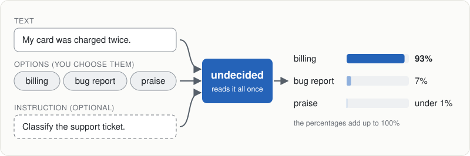
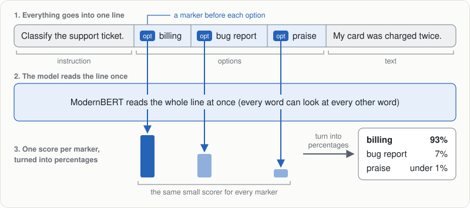
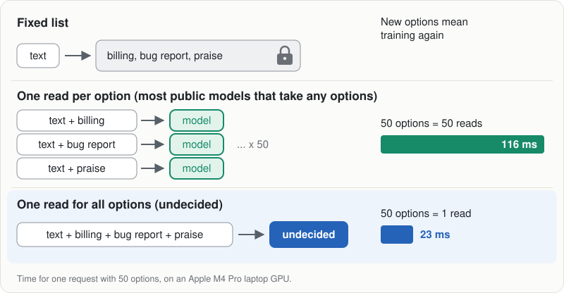
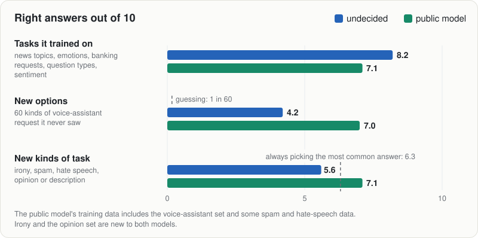
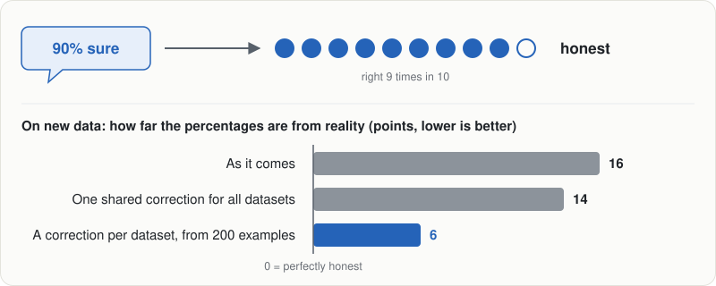

# undecided

A small AI model that sorts a text into options you choose at the moment you ask. Is this support
ticket about billing or a bug? Is this news story about sport or business? Give it the text and the options, and it says
how likely each option is.



```python
clf = Undecided.from_pretrained("runs/poc-warm")   # train it first, see "Try it"
clf.classify("My card was charged twice.",
             options=["billing", "bug report", "praise"],
             instruction="Classify the support ticket.")
# {"billing": 0.926, "bug report": 0.072, "praise": 0.002}
```

Built by one person in two and a half weeks on a laptop, as an open version of the idea behind
Jev, an online text-sorting service from the company TypeSafe. Every detail is in the [full report](REPORT.md).

## The idea

Think of a multiple-choice question. At the top is an instruction, below it the possible answers,
then the text to judge. `undecided` reads the whole sheet once and writes a percentage next to each
answer. The answers can change with every question, including answers it has never seen.

The reader is ModernBERT, a free public model built for reading text. It cannot chat like ChatGPT.
Training means showing it labelled examples and nudging it until its percentages favour the right
answers.

## How it works



Instruction, options and text are joined into one line, with a marker in front of each option. The
model reads the line once. A small scorer gives each marker a number, and the numbers become
percentages.

## Why one read matters



A classic classifier fixes its options during training, so a new option means training again. Most
public models that accept any options read the text once per option, so 50 options take 50 reads.
`undecided` reads everything once: about 23 milliseconds for 50 options on an Apple M4 Pro laptop's
GPU, 5 times faster than a public model that reads once per option. One other public model,
GLiClass, also reads everything once and is about as fast.

## Is it any good?



- **Tasks it trained on:** right about 8 times in 10.
- **New options, familiar kind of task:** sorting requests by what the person wants, as with the
  banking requests it trained on, but into 60 kinds of voice-assistant request it never saw, such
  as "turn the lights off". Right about 4 times in 10, where guessing manages 1 in 60.
- **New kinds of task** (irony, spam, hate speech, telling opinion from description): worse than
  always picking the most common answer, which scores well here because one answer is often far
  more common (only 15 in 100 of the messages are spam).

A public model that reads once per option does better on every test `undecided` was not trained
on. It learned from far more data and had already seen some of these tests, but it also wins on
irony and on telling opinion from description, which neither model had seen.

## Does it follow the instruction?

Barely. Removing the instruction, or swapping in another task's, changes the share of right answers
on familiar kinds of task by about 1 in 100. Probably because in training each task's instruction
always came with that task's options, so the options alone already gave the task away.

## Can you trust the percentages?



When the model says it is 90% sure, it should be right about 9 times in 10. That holds on the tasks
it trained on. On new data the percentages are off by about 16 points on average: too sure on some
datasets and too timid on others, so one shared correction (a simple rescaling of the
percentages) barely helps. A correction worked out from 200 labelled examples of each dataset
brings the gap down to about 6.

## Limits

- English only, and one answer per text.
- No trained model is published (each is 600 MB, and the data licences differ), so training comes
  first: about 70 minutes on an M4 Pro.
- Not affiliated with TypeSafe, and none of its methods are used.

## Try it

Needs [uv](https://docs.astral.sh/uv/), a Python package tool.

```text
uv sync
uv run python -m undecided.run configs/poc.yaml        # first training run, 53 min
uv run python -m undecided.run configs/poc-warm.yaml   # final model, 17 min more
uv run python -m undecided.classify runs/poc-warm "My card was charged twice." \
    --options billing "bug report" praise --instruction "Classify the support ticket."
```

## More

The [full report](REPORT.md) has every result, the open questions and what to try next. The
day-by-day record is in [the plan](plans/undecided.md). MIT licence ([`LICENSE`](LICENSE)).
