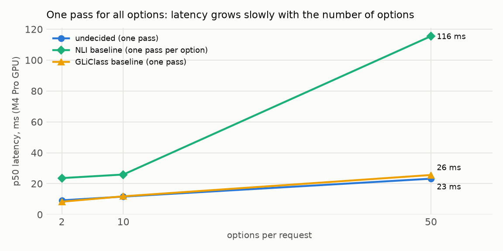

# undecided

A text classifier that takes its options at request time: pass a text, a list of options and an
optional instruction, and get one probability per option from a single forward pass of a
149M-parameter encoder. It is [ModernBERT-base](https://huggingface.co/answerdotai/ModernBERT-base)
with a one-output linear head, fine-tuned on a laptop GPU. It reimplements the interface of Jev,
TypeSafe's hosted classifier.

```python
clf = Undecided.from_pretrained("runs/poc-warm")   # train it first, see Usage
clf.classify("My card was charged twice.", options=["billing", "bug report", "praise"],
             instruction="Classify the support ticket.")
# {"billing": 0.926, "bug report": 0.072, "praise": 0.002}
```

Built solo in two and a half weeks (September to October 2026) with PyTorch, Hugging Face
transformers and peft. The plan, with a commit per step and every diagnosis, is in
[`plans/undecided.md`](plans/undecided.md).

- **Fast.** 12 ms per request at 10 options and 23 ms at 50 on an M4 Pro GPU, because all options
  share one pass. The NLI baseline, a public zero-shot model that runs one pass per option, is 5
  times slower at 50 options (3.5 times on CPU). GLiClass, which packs options the same way, is as
  fast on the GPU and about 20% slower at 50 options on CPU.
- **New labels partly work.** 0.42 accuracy on MASSIVE's 60 assistant intents, none seen in
  training (chance 0.02).
- **New kinds of task don't.** On irony, spam, hate speech and subjectivity the model does no
  better than always giving the most common answer, and the instruction adds almost no signal. The
  NLI baseline, trained on far more data (including Yahoo, MASSIVE and some spam and hate-speech
  sets), is more accurate on every held-out dataset.
- **Calibration doesn't transfer.** Confidence matches accuracy on the training tasks but not on
  new data. One global temperature barely helps; a temperature fitted on 200 labelled examples of each
  dataset fixes most of it.



## How it works

```text
[CLS] Classify the support ticket. [SEP] <opt> billing <opt> bug report <opt> praise [SEP] My card was charged twice. [SEP]
```

Instruction, options and text go into one sequence, each option preceded by `<opt>`, a token
added to the vocabulary. The encoder reads it all at once; a shared `Linear(768, 1)` scores the
hidden state at each `<opt>`, and a softmax over the options of the request gives the
probabilities. The model is about 20 lines on top of `transformers`
([`model.py`](src/undecided/model.py)).

| Design | Options at runtime | Cost per request |
|---|---|---|
| Fixed head, `Linear(768, N)` (classic fine-tuned BERT) | No, classes are frozen in the weights | 1 pass |
| NLI, one pass per option (most zero-shot pipelines) | Yes | N passes |
| **Packed options, per-option head** (this project, GLiClass) | Yes | 1 pass |

## Findings

The models: `poc`, the first full run (6 training datasets, 53 minutes); `poc-warm`, the final
model, which is `poc` trained one more epoch; `diverse-warm`, the same extra epoch on 10 datasets;
`head-only` and `lora`, `poc`'s schedule with a frozen encoder or with LoRA adapters.

**New labels transfer, partly.** `poc-warm` scores 0.422 on MASSIVE's 60 intents (chance 0.017),
whose plain-English names were written before any model was evaluated. On Yahoo Answers it scores
0.478, but 4 of Yahoo's 10 classes overlap AG News training labels: 0.575 on those, 0.415 on the
other 6 (chance 0.10). The NLI baseline scores 0.70 on MASSIVE, though its training mix includes it.

**New kinds of task don't.** On irony, SMS spam, hate speech and subjectivity, the average ranking
AUC is 0.52 ± 0.02 (0.5 is a coin flip), and no `undecided` model beats a dataset's majority
baseline by more than 0.011. Spam carries some signal (AUC 0.68), and every fully fine-tuned run
inverts subjectivity (AUC 0.34 to 0.40) for reasons not found.

**The instruction adds almost no signal.** Removing it, or swapping in another dataset's, moves
accuracy on the training and new-label datasets by at most 0.012, and AUC on the two-option
datasets by at most 0.05, except SMS spam (0.68 with its instruction, 0.58 without). On the unseen
tasks it shifts which answer the model prefers: irony accuracy rises from 0.478 to 0.597 without
its instruction, while AUC barely moves (0.53 to 0.55). The likely reason is that each training
task's instruction always arrives with that task's label set, so the options already identify the
task. On `poc`, five other wordings of the irony instruction and options all stayed below always
answering "not ironic".

**The encoder has to be trained.** On `poc`'s data and schedule, training only the head stays at
chance (0.23 mean accuracy on the five single-text training datasets, chance about 0.2), LoRA on 1%
of the weights reaches 0.47 (still improving when the schedule, tuned for full fine-tuning, ended)
and full fine-tuning 0.75. Comparing frozen ModernBERT embeddings of text and options by cosine
similarity scores 0.22, an unfair test since masked-language-model embeddings are not trained for
similarity.

**One temperature can't calibrate new data.** On the six held-out datasets, mean calibration
error is 0.161 raw, 0.140 with a global temperature fitted on the training tasks, and 0.058 with a
temperature fitted on 200 labelled examples of each dataset. The fitted temperatures fall on both
sides of 1 (SMS spam 0.55 sharpens, hate speech 3.87 softens), so no single value works, as the
[calibration critique of Jev](https://www.alexmolas.com/2026/09/23/jev-cant-be-calibrated.html)
predicts.

**Training starts with word overlap.** Per-dataset loss shows banking77 and TREC learning first,
since their label words appear in the text ("card arrival" for "my card hasn't arrived"); AG News
and SST-2 stay at chance until those two have started. The 10-dataset mix, with fewer banking77
and TREC examples, was still at chance after 2,000 steps from scratch, but learned when started
from `poc` (`diverse-warm`).

**Four more task types didn't help.** Adding QQP, QNLI, CoLA and BoolQ, and recasting 15% of
examples as two-option checks of one label ("sports" against "not sports", or yes/no), like the
unseen tasks, left unseen-task AUC at 0.51 against 0.52 for `poc-warm`. Trained on fewer examples of each original task,
`diverse-warm` also scored lower on the training tasks (0.78 against 0.82).

**Options influence each other.** Adding an irrelevant option ("recipe for pancakes") changes the
choice among the original options for 1% (emotion) to 14% (irony) of examples. Averaging the
probabilities of 4 option orders helps where there are many options: banking77 from 0.642 (the
mean of single orders) to 0.669, MASSIVE from 0.419 to 0.440, at 4 times the cost.

**Small gaps are noise.** A second training seed moves group averages by about 0.02 and single
datasets by up to 0.07, more than the sampling intervals in the table below (± 0.01 to ± 0.02), so
only the large effects above are firm.

## Questions and caveats

**Why did the first training run fail?** The new `<opt>` embedding was trained at the head's
learning rate. That first short run stayed near chance (0.308, chance 0.25) while a 64-example
overfit test passed, so the plumbing worked and training did not.
Text-token hidden states had become nearly identical (cosine similarity 0.594 untrained, 0.994
after 200 steps). Adam at 3e-5 can't move encoder weights that far in 200 steps, so the suspect
was the one fast input: the `<opt>` vector at 1e-3, which feeds every attention layer. At the
encoder's rate the collapse went away (0.428 accuracy after the same 200 steps, 0.863 after 3
epochs; [notes](results/tracer/NOTES.md)).

**Why stop the 10-dataset run at step 2,000 instead of waiting?** Its loss sat at 0.94 for 800 steps, against
1.00 for uniform guessing on that mix, while the learning rate was already decaying. A 1,000-step
probe with per-dataset logging, and a control run of the working mix, then showed why: banking77
never left chance, where in the working mix it is the first to learn.

**Is the inverted subjectivity a label bug?** No: GLiClass (AUC 0.96) and the NLI baseline (0.63)
rank the same records correctly. The objective sentences are movie plot summaries, and one suspect
was that emotional plots read as subjective. Asked for sentiment, the model rates objective
sentences as less intense than subjective ones (0.54 against 0.69 on a 0 to 1 scale), so that was
ruled out. The cause is open.

**How would you make the model use the instruction?** Train on examples whose options don't
identify the task: the same text and the same yes/no options with different questions ("Is this
ironic?", "Is this about sport?"), so only the instruction says what to judge, and check it with
the instruction probe. `diverse-warm`'s recast checks were a weak version, with too few questions
and only about half with yes/no options.

**Is the baseline comparison fair?** Partly. The NLI baseline's [model card](https://huggingface.co/MoritzLaurer/ModernBERT-base-zeroshot-v2.0)
reports results for a training mix that includes Yahoo, MASSIVE, banking77, emotion, AG News, a
spam and two hate-speech datasets, so most of its wins here are not zero-shot. Irony and
subjectivity are not in that list. It also differs in method (an entailment pass per option), so
data and formulation can't be separated. Both baselines run in float32 on the GPU, like
`undecided`; a first run had GLiClass silently on the CPU and the NLI model in bfloat16.

**How much would a full rerun vary?** More than measured: the second seed re-ran only the final
17-minute warm step, so its spread is a lower bound. The final model was also chosen on the
evaluation sets, with no separate validation split. On new labels and unseen tasks the candidates
differ by about the seed noise; on the training tasks `poc-warm`'s lead (0.035) is larger, so the
choice may favour it slightly there.

## Results

Group means with 95% intervals (binomial for accuracy, Hanley-McNeil for AUC). They are
conservative for comparing models on the same examples; per-example predictions for paired tests
were not kept. "Training tasks" are the five single-text datasets every `undecided` model trained on;
MNLI is left out because the baselines skip it (`poc-warm` scores 0.78 with it included). "New
labels" are Yahoo and MASSIVE; "unseen tasks" are the four task types above.

| Model | Training tasks | New labels | Unseen tasks, AUC | Held-out calibration error |
|---|---|---|---|---|
| `poc` | 0.75 ± 0.01 | 0.40 ± 0.02 | 0.51 ± 0.02 | 0.15 |
| `poc-warm` (final) | **0.82 ± 0.01** | 0.45 ± 0.02 | 0.52 ± 0.02 | 0.16 |
| `poc-warm`, second seed | 0.80 ± 0.01 | 0.43 ± 0.02 | 0.51 ± 0.02 | 0.15 |
| `diverse-warm` | 0.78 ± 0.01 | 0.43 ± 0.02 | 0.51 ± 0.02 | 0.17 |
| `lora` | 0.47 ± 0.01 | 0.28 ± 0.02 | 0.48 ± 0.02 | 0.17 |
| `head-only` | 0.23 ± 0.01 | 0.07 ± 0.01 | 0.50 ± 0.02 | 0.07 |
| Frozen embeddings, no training | 0.22 ± 0.01 | 0.10 ± 0.01 | 0.52 ± 0.02 | n/a |
| NLI baseline | 0.71 ± 0.01 | **0.67 ± 0.02** | **0.75 ± 0.02** | 0.15 |
| GLiClass baseline | 0.39 ± 0.01 | 0.23 ± 0.02 | 0.67 ± 0.02 | 0.15 |

`head-only`'s low calibration error comes from near-uniform probabilities.

Per dataset, `poc-warm` against the baselines (accuracy, AUC in brackets for two-option sets):

| Dataset | Options | Chance or majority | `poc-warm` | NLI baseline | GLiClass |
|---|---|---|---|---|---|
| AG News topics | 4 | 0.25 | 0.899 | 0.898 | 0.643 |
| emotion | 6 | 0.17 | 0.901 | 0.763 | 0.271 |
| banking77 intents | 77 | 0.01 | 0.651 | 0.657 | 0.091 |
| TREC question types | 50 | 0.02 | 0.772 | 0.332 | 0.094 |
| SST-2 sentiment | 2 | 0.51 | 0.858 (0.93) | 0.916 (0.97) | 0.866 (0.96) |
| Yahoo Answers topics | 10 | 0.10 | 0.478 | 0.647 | 0.412 |
| MASSIVE assistant intents | 60 | 0.02 | 0.422 | 0.702 | 0.050 |
| tweet irony | 2 | 0.60 | 0.478 (0.53) | 0.707 (0.78) | 0.361 (0.46) |
| SMS spam | 2 | 0.85 | 0.837 (0.68) | 0.987 (0.99) | 0.648 (0.68) |
| tweet hate speech | 2 | 0.56 | 0.517 (0.54) | 0.582 (0.59) | 0.513 (0.60) |
| subjectivity | 2 | 0.51 | 0.402 (0.34) | 0.561 (0.63) | 0.819 (0.96) |

Latency, one request at a time with a 20-word text, p50 in milliseconds on an Apple M4 Pro:

| Options | `undecided`, GPU | `undecided`, CPU | NLI baseline, GPU | NLI baseline, CPU | GLiClass, GPU | GLiClass, CPU |
|---|---|---|---|---|---|---|
| 2 | 9.2 | 18.7 | 23.6 | 27.1 | 8.3 | 18.6 |
| 10 | 11.6 | 28.7 | 25.9 | 51.4 | 11.8 | 30.9 |
| 50 | 23.2 | 49.5 | 115.5 | 174.7 | 25.6 | 59.9 |

Calibration on the held-out datasets, `poc-warm` (expected calibration error, 15 bins; diagram in
[`results/poc-warm/plots/reliability.png`](results/poc-warm/plots/reliability.png)):

| Dataset | Raw | Global T = 1.18 | Own T, 200 examples |
|---|---|---|---|
| Yahoo Answers topics | 0.258 | 0.210 | 0.066 |
| MASSIVE assistant intents | 0.117 | 0.063 | 0.050 |
| tweet irony | 0.142 | 0.122 | 0.068 |
| SMS spam | 0.117 | 0.144 | 0.021 |
| tweet hate speech | 0.086 | 0.073 | 0.038 |
| subjectivity | 0.246 | 0.227 | 0.106 |

Every run's per-dataset numbers are in `results/<run>/metrics.json`; the probes (instructions,
calibration, option orders, distractor, Yahoo split, subjectivity, examples) are in
`results/poc-warm/probe-*.json`, and the day-by-day record with every diagnosis is in the
[plan](plans/undecided.md).


## What to try next

- **Far broader training data, generated.** An LLM can write task descriptions, label sets and
  examples for hundreds of invented tasks; the held-out sets here can tell whether that transfers.
- **Training data where only the instruction decides** the answer (see the questions above).
- **A curriculum:** many-option intent data first, harder task types after.
- **LoRA with its own schedule.**
- **A sentence-embedding bi-encoder baseline** (e5, gte or bge), the fair version of the frozen
  comparison, and paired tests on kept per-example predictions.

## Data and training

Training: [AG News](https://huggingface.co/datasets/fancyzhx/ag_news),
[emotion](https://huggingface.co/datasets/dair-ai/emotion),
[banking77](https://huggingface.co/datasets/mteb/banking77),
[TREC](https://huggingface.co/datasets/SetFit/TREC-QC),
[SST-2](https://huggingface.co/datasets/stanfordnlp/sst2) and
[MNLI](https://huggingface.co/datasets/nyu-mll/multi_nli), plus
[QQP, QNLI, CoLA](https://huggingface.co/datasets/nyu-mll/glue) and
[BoolQ](https://huggingface.co/datasets/google/boolq) for `diverse-warm`. Held out:
[Yahoo Answers](https://huggingface.co/datasets/community-datasets/yahoo_answers_topics),
[MASSIVE](https://huggingface.co/datasets/SetFit/amazon_massive_intent_en-US) (intents hand-named
as a user would write them, e.g. "turn the lights off"), and four task types
never trained on: [tweet irony and hate speech](https://huggingface.co/datasets/cardiffnlp/tweet_eval),
[SMS spam](https://huggingface.co/datasets/ucirvine/sms_spam) and
[subjectivity](https://huggingface.co/datasets/SetFit/subj). Evaluation offers every label of a
dataset at once (MASSIVE: 60 options in one sequence, though training never showed more than 16),
on fixed samples of 500 to 1,000 examples.

Each training example is rebuilt on the fly: 2 to 16 sampled options, shuffled, some label
paraphrases, 4 to 8 instruction templates per task and no instruction 20% of the time. Two-text
tasks put the second text in the instruction (`Does this sentence answer the question "..."?`).
The whole model is fine-tuned with AdamW: the head at 1e-3, the encoder and the `<opt>` vector at
3e-5, batch 16, fp32, on an M4 Pro through MPS at 19 to 30 examples per second (11 to 19 GB of GPU
memory). The CUDA path exists but was never run.

## Usage

No weights are published (600 MB each, and the dataset licences differ), so training comes first:
about 70 minutes on an M4 Pro.

```text
uv sync                                                        # from a clone of this repository
uv run python -m undecided.run configs/poc.yaml                # first run, saves runs/poc (53 min)
uv run python -m undecided.run configs/poc-warm.yaml           # final model, runs/poc-warm (17 min)
uv run python -m undecided.classify runs/poc-warm "My card was charged twice." \
    --options billing "bug report" praise --instruction "Classify the support ticket."
uv run python -m undecided.run configs/poc.yaml --eval-only    # re-evaluate a checkpoint
uv run python -m undecided.run configs/lora.yaml --resume      # continue an interrupted run
uv run python -m undecided.probe instructions configs/poc-warm.yaml   # also: calibration, orders,
                                                               # distractor, yahoo, subjectivity, biencoder
uv run python -m undecided.baselines configs/poc-warm.yaml     # the NLI baseline
uv run pytest                                                  # 68 tests
```

Code: [`src/undecided/`](src/undecided/) (data, augmentation, encoding, model, training, evaluation,
probes, baselines); configs in [`configs/`](configs/); results, plots and notes in
[`results/`](results/). Python 3.12, `torch` 2.14, `transformers` 5.17 and `peft`, locked in
`uv.lock`.

## Background and limitations

Jev, from TypeSafe, reportedly answers in one pass of 70 to 500 ms and is said to be trained for
calibrated confidence
([MindStudio](https://www.mindstudio.ai/blog/jev-vs-classic-classifiers-benchmark),
[Towards Data Science](https://towardsdatascience.com/jev-vs-llms-when-ai-moves-from-generation-to-decision-making/),
[XenoSpectrum](https://xenospectrum.com/en/jev-typesafe-bert-classifier-decomposition/)). This
project uses none of TypeSafe's methods and is not affiliated with TypeSafe. It is English only and
single-label, and each model was trained once apart from one seed check of the final step. The code is MIT licensed ([`LICENSE`](LICENSE)); check each dataset's licence before publishing trained weights.
