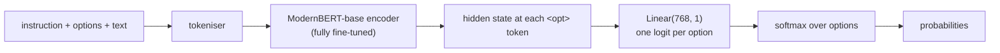

# undecided

A small, open reproduction of the idea behind Jev: a classifier that never generates text and
instead returns probabilities over options you choose at request time. This version is built on
[ModernBERT-base](https://huggingface.co/answerdotai/ModernBERT-base) (149M parameters) with a
linear head that scores each option, and it is sized to be fine-tuned on a laptop GPU.

> **Status:** in progress. Phases 1 to 4 of the [implementation plan](plans/undecided.md) are
> done. The proof-of-concept model trains on six datasets in 53 minutes on the laptop and scores
> 0.48 to 0.88 accuracy in-distribution. On labels it never saw it is well above chance (0.47 on
> Yahoo's 10 topics, 0.33 on MASSIVE's 60 intents), but on task types it never saw (irony, spam,
> hate speech, subjectivity) it does no better than guessing ([notes](results/poc/NOTES.md)).
> Phase 4b, a retrain with more varied task types, comes before calibration. Latency, baselines
> and ablations are still a plan. This is a case study: the goal is a working proof of concept
> with honest numbers.
>
> Not affiliated with TypeSafe. "Jev" refers to their product and is used here only to
> describe the behaviour being reproduced.

## What Jev does

According to the public write-ups ([MindStudio](https://www.mindstudio.ai/blog/jev-vs-classic-classifiers-benchmark),
[Towards Data Science](https://towardsdatascience.com/jev-vs-llms-when-ai-moves-from-generation-to-decision-making/),
[XenoSpectrum](https://xenospectrum.com/en/jev-typesafe-bert-classifier-decomposition/)):

- TypeSafe calls it a "System One" model. It returns probabilities over the options you define
  and does not produce text or a chain of thought.
- It answers in a single pass, in 70 to 500 ms.
- It is trained with reinforcement learning for calibrated decisions (RL-CD), meant to make a
  90% confidence score correspond to 90% real accuracy.
- In published comparisons, locally trained classifiers win on raw accuracy for a fixed task,
  and Jev wins on zero-shot flexibility and on instructions that change at runtime.

The calibration claim is disputed. [Alex Molas argues](https://www.alexmolas.com/2026/09/23/jev-cant-be-calibrated.html)
that calibration depends on the data distribution, which a zero-shot model never sees, so
Jev's probabilities can't be calibrated for your data.

## The idea

The target is Jev's interface. Its training recipe and architecture stay out of scope, and
what gets reproduced is the contract:

```text
input:   text, a list of options, an optional instruction
output:  one probability per option, summing to 1
cost:    one forward pass of a small encoder
```

The case study answers five questions:

1. How much of that zero-shot behaviour does a 149M-parameter encoder fine-tuned on public
   classification datasets actually get?
2. How well does it handle labels it never saw in training, and a task type it never saw?
3. Are its probabilities calibrated, and does a single global fix (temperature scaling) help
   on new datasets, or does it need target data, as the Molas post predicts?
4. How fast is it on a laptop, and how does latency grow with the number of options?
5. What does fine-tuning the encoder buy compared with training only the head?

## Architecture

### Input format

Instruction, options and text go into **one sequence**. Each option is preceded by a new
special token, `<opt>`:

```text
[CLS] Classify the support ticket. [SEP] <opt> billing <opt> bug report <opt> praise [SEP] My card was charged twice. [SEP]
```

The instruction is optional. When the sequence is too long, only the text is truncated, never
the options.

### Model



The encoder reads the whole sequence, a single `Linear(768, 1)` scores the hidden state at each
`<opt>` token, and a softmax across the options of that example turns the scores into
probabilities. [Why this design](#why-this-design) explains how that works and why the options
can change at runtime.

The whole model is a few lines on top of `transformers`
([`src/undecided/model.py`](src/undecided/model.py)):

```python
class OptionScorer(nn.Module):
    def __init__(self, encoder, opt_token_id):
        super().__init__()
        self.encoder = encoder                                       # AutoModel.from_pretrained(...)
        self.head = nn.Linear(encoder.config.hidden_size, 1)
        self.opt_token_id = opt_token_id
        pretrained = encoder.get_input_embeddings().weight.detach()
        self.opt_embedding = nn.Parameter(pretrained.mean(dim=0).clone())

    def forward(self, input_ids, attention_mask):
        is_opt = input_ids == self.opt_token_id                      # (batch, seq)
        safe_ids = input_ids.masked_fill(is_opt, self.encoder.config.pad_token_id)
        embeds = self.encoder.get_input_embeddings()(safe_ids)
        embeds = torch.where(is_opt[..., None], self.opt_embedding, embeds)

        hidden = self.encoder(inputs_embeds=embeds, attention_mask=attention_mask).last_hidden_state
        counts = is_opt.sum(dim=1)                                   # options per example
        max_opts = int(counts.max())
        opt_mask = torch.arange(max_opts, device=hidden.device)[None] < counts[:, None]
        opt_hidden = hidden.new_zeros(hidden.size(0), max_opts, hidden.size(-1))
        opt_hidden[opt_mask] = hidden[is_opt]                        # (batch, max_opts, hidden)
        logits = self.head(opt_hidden).squeeze(-1)
        return logits.masked_fill(~opt_mask, float("-inf"))          # padded options get p = 0
```

Training loss is plain cross-entropy between these logits and the index of the correct option.

### Why this design

A head is the small layer on top of the encoder that turns its output into an answer. The
three common designs differ in where the label names live, and that decides whether options
can change at runtime.

| Design | Options at runtime | Cost per request | Used by |
|---|---|---|---|
| Fixed head, `Linear(768, N)` | No, the N classes are frozen at training time | 1 pass | Classic fine-tuned BERT |
| Natural-language inference (NLI), one pass per option | Yes | N passes | `ModernBERT-base-zeroshot-v2.0`, most zero-shot pipelines |
| **Packed options, per-option head** | Yes | 1 pass | This project, GLiClass |

#### Fixed head: labels live in the weights

```text
[CLS] My card was charged twice. [SEP]
        │
     encoder
        │
   CLS vector (768 numbers)
        │
  Linear(768, 3)        one row of weights per class
        │
  [billing, bug report, praise]  →  softmax
```

`Linear(768, 3)` has exactly 3 rows of weights, and each row is one class. Row 0 learned what
billing looks like from thousands of billing examples. The model never reads the word
"billing": label names exist only in the calling code, as a lookup from row 0 to a string.

So at request time:

- An option can't be added. There is no row for "refund request".
- An option can't be renamed. Calling class 0 "payment issue" changes nothing, the model still
  means whatever row 0 was trained on.
- The model can't be reused for another task. Sentiment needs a new head and new training.

Passing the options with every request, including options nobody trained on, is the point of
Jev. A fixed head can't do it, so a fixed head can't be a Jev clone.

#### One pass per option: labels live in the input, one at a time

NLI-based zero-shot models read labels as text, but they run the encoder once per option:
"My card was charged twice" paired with "This is about billing" gives a yes/no score, then the
same again for every other option. That handles new labels, with two drawbacks:

- 60 options cost 60 forward passes.
- Each option is scored alone, so the model never learns to weigh one option against another,
  and the probabilities aren't trained as a real distribution.

#### Packed options: labels live in the input, all together

```text
[CLS] Classify the support ticket. [SEP] <opt> billing <opt> bug report <opt> praise [SEP] My card was charged twice. [SEP]
                                         │             │                │
                              the encoder reads everything together, with attention
                                         │             │                │
                                     vector at     vector at        vector at
                                     1st <opt>     2nd <opt>        3rd <opt>
                                         │             │                │
                                 Linear(768, 1), the same layer applied to each
                                         │             │                │
                                        2.9          -0.4             -1.8      one score per option
                                         └────────── softmax ───────────┘
                                       0.91          0.07             0.02     (illustrative numbers)
```

1. **The head has one output.** `Linear(768, 1)` answers a single, generic question: how well
   does this option fit? It knows nothing about billing or praise. The same layer is applied to
   every option, so 3 options or 60 make no difference to it.
2. **The encoder does the comparison.** Each `<opt>` token sits right before its label, and
   attention lets it look at its own label words, the text and the instruction. After
   fine-tuning, the vector at each `<opt>` summarises "this label against this text". This is
   why the encoder has to be fine-tuned: a frozen encoder was never trained to make that
   comparison, so the vector would hold nothing useful for the head to score.
3. **The softmax runs over the options of each request.** Probabilities are relative: 0.91
   means "billing beats the other two options it was given". Different options give a different
   distribution, which matches how Jev behaves.

Compared with one pass per option, packing keeps a single forward pass however many options
there are, and the softmax is trained over the options that actually compete.

#### Why unseen labels can work

Training shows the model many (text, option set, correct option) triples from different
datasets, with label names in plain words. What it has to learn is the general skill of matching
a text to a label description, since memorising 77 banking intents doesn't help on the other
datasets. At test time, "alarm set" or "irony" are words it reads, like the text. The held-out
datasets check whether that skill actually transfers.

#### What packing costs

- **Position bias.** Options can see each other and their order, so the model may learn "the
  first option is usually right". Training shuffles the option order every time, and the
  evaluation measures accuracy by the correct option's position.
- **Context budget.** Every option costs tokens. 60 short intent labels take a few hundred
  tokens, which fits easily in ModernBERT's 8,192-token context, but very long option
  descriptions would not scale.

### Backbone choice

The backbone is ModernBERT-base, an encoder. It fits this project for four reasons:

- **Bidirectional attention.** An encoder reads the whole input in both directions at once, so
  every `<opt>` token sees the text, the instruction and the other options, wherever they sit
  in the sequence. A decoder LLM reads left to right, so an option could only see what comes
  before it, and the input would need careful ordering to compensate.
- **Size.** 149M parameters keeps inference fast and makes a full fine-tune on a laptop
  practical, which in turn makes the ablations affordable. Single-pass speed is also the
  property Jev is sold on.
- **ModernBERT over older BERTs.** The 8,192-token context (classic BERT and DeBERTa stop at
  512) fits 60 or more options in one sequence. It also has a more recent tokeniser, more
  pretraining data and faster inference.
- **Prior art.** GLiClass and the zero-shot v2.0 models already use ModernBERT for zero-shot
  classification, and sharing the backbone with those baselines means the comparison isolates
  the architecture.

The expected weakness is instruction following and world knowledge. A 149M encoder should do
well at matching a text to a set of labels and poorly at conditional rules such as "mark it
urgent only if the customer mentions a deadline, otherwise normal". That matches the published
Jev comparisons, where fine-tuned local classifiers won on accuracy and Jev won on runtime
instructions. The "no instructions" ablation measures how much the model actually uses the
instruction.

Alternatives, if the results call for them:

| Backbone | Better when | Cost |
|---|---|---|
| **ModernBERT-base** (default) | Proof of concept, speed, local training | |
| [ModernBERT-large](https://huggingface.co/answerdotai/ModernBERT-large) (395M) | Accuracy falls short with base | Roughly 2 to 3 times slower, still fits in 48 GB |
| [DeBERTa-v3-base](https://huggingface.co/microsoft/deberta-v3-base) | Often slightly stronger on NLI-style tasks | 512-token limit, slower, awkward in fp16 |
| [mmBERT-base](https://huggingface.co/jhu-clsp/mmBERT-base) | Non-English text; ModernBERT is English and code only | Similar size |
| Small decoder LLM (0.5B to 1.5B), same per-option head | Instruction following matters more than speed | Several times slower, harder to train locally, needs the left-to-right workaround |

Swapping the backbone is a one-line config change, so the proof of concept starts with base
and revisits the choice at milestone 6. New encoders keep appearing, so the list above is worth
checking again at that point.

The bigger risk to the result is the training data. If every instruction comes from a small set
of simple templates, a larger backbone won't learn to follow unusual ones either.

## Data

### Unified format

Every source dataset is converted into the same record:

```json
{
  "instruction": "What is the intent of this banking customer message?",
  "text": "I still haven't received my new card, it's been two weeks.",
  "options": ["card arrival", "lost or stolen card", "top up failed", "exchange rate"],
  "answer_idx": 0,
  "source": "banking77"
}
```

### Training datasets

| Dataset | Task | Labels | Notes |
|---|---|---|---|
| [`fancyzhx/ag_news`](https://huggingface.co/datasets/fancyzhx/ag_news) | news topic | 4 | |
| [`dair-ai/emotion`](https://huggingface.co/datasets/dair-ai/emotion) | emotion | 6 | |
| [`mteb/banking77`](https://huggingface.co/datasets/mteb/banking77) | banking intent | 77 | many fine-grained options |
| [`SetFit/TREC-QC`](https://huggingface.co/datasets/SetFit/TREC-QC) | question type | 50 (fine-grained) | ships human-readable label names |
| [`stanfordnlp/sst2`](https://huggingface.co/datasets/stanfordnlp/sst2) | sentiment | 2 | the test split is unlabelled, validation is used for evaluation |
| [`nyu-mll/multi_nli`](https://huggingface.co/datasets/nyu-mll/multi_nli) | NLI, recast | 3 | premise as text, hypothesis in the instruction |

The original `PolyAI/banking77` and `CogComp/trec` repos rely on loading scripts, which recent
versions of `datasets` no longer run, so the parquet and JSONL mirrors above are used instead.

### Held-out datasets (never seen in training)

| Dataset | Task | Labels | What it tests |
|---|---|---|---|
| [`community-datasets/yahoo_answers_topics`](https://huggingface.co/datasets/community-datasets/yahoo_answers_topics) | question topic | 10 | new labels, familiar task type |
| [`SetFit/amazon_massive_intent_en-US`](https://huggingface.co/datasets/SetFit/amazon_massive_intent_en-US) | assistant intent | 60 | new labels, far more options than seen in training |
| [`cardiffnlp/tweet_eval`](https://huggingface.co/datasets/cardiffnlp/tweet_eval) (`irony`) | irony detection | 2 | a task type absent from training |
| [`ucirvine/sms_spam`](https://huggingface.co/datasets/ucirvine/sms_spam) | spam detection | 2 | a task type absent from training, in a new domain |
| [`cardiffnlp/tweet_eval`](https://huggingface.co/datasets/cardiffnlp/tweet_eval) (`hate`) | hate speech | 2 | a task type absent from training, on tweets like irony |
| [`SetFit/subj`](https://huggingface.co/datasets/SetFit/subj) | subjectivity | 2 | a task type absent from training, in a familiar domain |

The held-out datasets are the core of the case study. In-distribution accuracy only shows that
the model learned its training data; accuracy on these shows whether it learned to
classify. The last three were added in Phase 4b, after irony failed, to tell a hard task apart
from unseen task types failing in general.

Options are worded as a user would type them. Yahoo's topics and irony's two classes ("ironic",
"not ironic") need no help. MASSIVE's raw intents are terse ("iot_hue_lightoff",
"email_querycontact"), so each of the 60 has a hand-written name ("turn the lights off", "look up a
contact"), fixed in `tasks.py` before the first held-out evaluation. Evaluation samples are 1,000
Yahoo questions, 1,000 MASSIVE utterances with all 60 intents offered at once, and all 784 irony
test tweets (60% not ironic, so always answering "not ironic" scores 0.60).

### Augmentation

Each training example is rebuilt on the fly, so every epoch sees different variants:

- **Option sampling.** 2 to 16 options per example: the correct label plus distractors drawn
  from the same dataset's other labels. Label sets of 3 or fewer (sentiment, NLI) always use all
  labels, since dropping one would change the task.
- **Shuffling.** Option order is random every time.
- **Label verbalisation.** Raw labels become readable phrases: `alarm_set` becomes "alarm set",
  TREC's `DESC:manner` uses its shipped name "manner of an action". A few labels per dataset
  have hand-written paraphrases ("science and technology" can become "sci-tech"), swapped in
  30% of the time so the model doesn't memorise exact strings.
- **Instructions.** 8 templates per task type, plus no instruction at all in 20% of examples.
  MNLI is the exception: its 6 templates carry the hypothesis, so one is picked per example when
  loading and always kept. Templates and paraphrases live in
  [`src/undecided/tasks.py`](src/undecided/tasks.py).
- **Balancing.** Each dataset is capped (5,000 examples in the proof of concept) so that the
  large ones, MNLI and AG News, don't drown out the rest.

Out of scope for the proof of concept: multi-label examples (sigmoid instead of softmax), and
synthetic instruction-heavy data generated with an LLM.

## Training

### What gets trained

The **whole model**: all 149M encoder parameters plus the head. Training only the head can't
work for this design, for the reason given in [Packed options](#packed-options-labels-live-in-the-input-all-together):
the comparison between option and text happens inside the encoder. The head-only ablation
measures this directly.

`<opt>` is a new token. It is added to the tokeniser, but its vector is a separate parameter
rather than a new row in ModernBERT's embedding matrix: the model looks up every other token
normally and writes the `<opt>` vector in at the marker positions. The vector starts as the mean
of the pretrained token embeddings, a neutral starting point.

Two learning rates keep the pretrained weights safe while the new head catches up:

| Parameters | Learning rate |
|---|---|
| head | 1e-3 |
| encoder, including the `<opt>` vector | 3e-5 |

The `<opt>` vector started out in the fast group, and the tracer run showed why that was wrong:
it feeds every attention layer, and moving it at 1e-3 collapsed the whole encoder output within
200 steps (every token ended up with nearly the same hidden state, and accuracy stayed at chance).
The measurements are in [`results/tracer/NOTES.md`](results/tracer/NOTES.md).

### Hyperparameters

| | Proof of concept (local) | Full run (cloud) |
|---|---|---|
| Training examples | ~30k (5k per dataset) | ~200k |
| Max sequence length | 512, dynamic padding | 512, dynamic padding |
| Batch size | 16 to 32 | 32 |
| Epochs | 1 to 2 | 1 to 2 |
| Precision | fp32, then fp16 autocast if stable | bf16 |
| Optimiser | AdamW, weight decay 0.01, 6% warmup, linear decay, gradient clipping at 1.0 | same |

Sequences are grouped by length before batching, so a batch of short tweets doesn't pay for
one long news article.

### Hardware: local first

The proof of concept runs on an Apple M4 Pro (20-core GPU, 48 GB unified memory) through
PyTorch's MPS backend. ModernBERT-base fully fine-tuned fits comfortably. Settings that
matter on MPS:

- `PYTORCH_ENABLE_MPS_FALLBACK=1`, so any unsupported operation falls back to the CPU instead
  of crashing.
- No flash-attention on macOS. ModernBERT falls back to standard padded attention, which is
  slower but correct.
- fp32 first. Mixed precision on MPS can still produce NaNs with some operations.

Measured: 27.5 examples per second at batch size 16 in the tracer run (AG News only), and 19.0
in the proof-of-concept run (30,000 examples, 2 epochs, 52.6 minutes, peak MPS memory 11.5 GB).
The MPS allocator cache grows as new batch shapes appear, so the run clears it every 200 steps.

The code picks `cuda`, `mps` or `cpu` automatically, so the same script runs unchanged in the
cloud.

### Cloud, for the full run

Approximate prices, checked in September 2026. They change often.

| Service | GPU | Price | Notes |
|---|---|---|---|
| Kaggle Notebooks | 2× T4 or P100 | free, about 30 GPU hours a week | the full run takes a few hours |
| Google Colab | T4 free, A100 on Pro | free or about $10 a month | free sessions disconnect |
| RunPod / Vast.ai | RTX 4090 | ~$0.35 to $0.70 an hour | best value, full run in 1 to 2 hours |
| RunPod / Lambda | A100 80GB | ~$1.20 to $1.90 an hour | full run in under an hour |
| Modal | A100 / H100 | per second | launch a Python function, no machine to manage |

Expected cost of the full run: $2 to $5 per run, under $20 with a few iterations.

## Evaluation

### Metrics

| Metric | What it answers |
|---|---|
| Accuracy, macro-F1 | Does it pick the right option? Macro-F1 stops frequent classes from hiding failures on rare ones. |
| Expected calibration error (ECE, 15 bins), Brier score, log loss | When it says 80%, is it right 80% of the time? |
| Reliability diagrams | The same question as a picture, one per dataset |
| Latency p50 / p95 at 2, 10 and 60 options | How long does one request take? Batch size 1, on MPS and on CPU. |
| Accuracy by correct-option position | Position bias: is the first option favoured? |

Every metric is reported separately for three groups: training datasets (validation splits),
held-out datasets with new labels, and the held-out task type (irony).

### The calibration experiment

This experiment tests the calibration dispute described in [What Jev does](#what-jev-does).
Temperature scaling divides all logits by one learned number T, and it is fitted in two ways:

1. **Global T**, fitted once on the training datasets' validation splits, then applied
   unchanged to the held-out datasets. This is what a zero-shot model can do on its own.
2. **Per-dataset T**, fitted on 200 labelled examples from each held-out dataset. This is what
   a user with a little labelled data can do.

If global T fixes calibration on held-out data, the model generalises its confidence. If only
per-dataset T works, the Molas argument holds for this model too.

### Baselines

| Model | Why |
|---|---|
| Random, majority class | the floor |
| [`MoritzLaurer/ModernBERT-base-zeroshot-v2.0`](https://huggingface.co/MoritzLaurer/ModernBERT-base-zeroshot-v2.0) | same backbone, one pass per option: isolates the effect of the architecture |
| [`MoritzLaurer/deberta-v3-base-zeroshot-v2.0`](https://huggingface.co/MoritzLaurer/deberta-v3-base-zeroshot-v2.0) | a widely used zero-shot baseline |
| [`knowledgator/gliclass-modern-base-v2.0-init`](https://huggingface.co/knowledgator/gliclass-modern-base-v2.0-init) | closest prior art: ModernBERT with packed options |
| Jev | optional, only if API access is available |

### Ablations

Each is one extra training run, about 50 minutes on the laptop.

| Ablation | Question |
|---|---|
| Head only vs LoRA (small trainable adapters on a frozen encoder) vs full fine-tune | How much of the result comes from adapting the encoder? |
| Option shuffling off | How strong is position bias without it? |
| Max options at training time, 4 vs 16 | Does training on few options hurt on MASSIVE's 60? |
| No instructions | Do instructions help, or does the model ignore them? |
| Option pooling: `<opt>` vector vs mean of the label's own tokens | Does averaging the label tokens ("bug", "report") beat reading the single `<opt>` marker, especially on long multi-word labels? Needs start and end offsets for each label in the collator. |

## Results

To be filled in. The remaining ablations get a table of their own.

| Model | In-distribution acc. | Held-out acc. | Unseen task acc. | ECE (held-out) | p50 latency, 10 options |
|---|---|---|---|---|---|
| Random | | | | | |
| ModernBERT-base-zeroshot-v2.0 | | | | | |
| GLiClass modern base | | | | | |
| **undecided (full fine-tune)** | | | | | |
| undecided (head only) | | | | | |
| undecided (LoRA) | | | | | |
| undecided (full run, cloud) | | | | | |

## Usage

```python
from undecided import Undecided

clf = Undecided.from_pretrained("runs/poc")                # any run directory under runs/
clf.classify(
    "My card was charged twice.",
    options=["billing", "bug report", "praise"],
    instruction="Classify the support ticket.",
)
# {"billing": 0.91, "bug report": 0.07, "praise": 0.02}   (illustrative output)
```

The same from the terminal:

```text
uv run python -m undecided.classify runs/poc "My card was charged twice." \
    --options billing "bug report" praise --instruction "Classify the support ticket."
```

`classify()` rejects duplicate options, fewer than 2 options, and more options than fit in the
checkpoint's max length. The device is picked automatically (`cuda`, then `mps`, then `cpu`), or
passed as `from_pretrained(path, device=...)`.

Training, evaluation and the results tables:

```text
uv run python -m undecided.run configs/poc.yaml               # train, evaluate, save runs/poc
uv run python -m undecided.run configs/poc.yaml --eval-only   # re-evaluate runs/poc, no training
uv run python -m undecided.results results/poc results/tracer # Markdown tables for this README
```

## Layout

```text
undecided/
├── src/undecided/
│   ├── data.py        # conversion of each dataset into the unified record format
│   ├── sources.py     # where each dataset is downloaded from, sampling with a fixed seed
│   ├── tasks.py       # instruction templates and label paraphrases per dataset
│   ├── augment.py     # instructions, option sampling, paraphrasing and shuffling
│   ├── encoding.py    # packed <opt> input format, collation
│   ├── model.py       # OptionScorer and the Undecided wrapper (save, load, classify)
│   ├── train.py       # training loop, two learning-rate groups
│   ├── evaluate.py    # accuracy, macro-F1, accuracy by position; calibration later
│   ├── run.py         # one experiment from a YAML config, or re-evaluation of a checkpoint
│   ├── results.py     # Markdown tables from results/*/metrics.json
│   ├── preview.py     # prints augmented examples and label counts for a config
│   └── classify.py    # command-line classification with a checkpoint
├── tests/
├── configs/           # one YAML file per run (tracer, poc; full later)
├── plans/             # the implementation plan
├── baselines/         # planned: comparison models on the same eval sets
├── results/           # metrics JSON, plots and notes per run, committed
└── runs/              # checkpoints, gitignored
```

Tooling: `uv`, Python 3.12, `torch`, `transformers>=4.48` (the first release with ModernBERT;
developed on 5.17), `datasets`, `scikit-learn`, `matplotlib`.

## Milestones

Each milestone has an exit check, so progress is visible and a broken step is caught early.

- [x] **0. Setup and benchmark.** Project skeleton, device detection, a 200-step throughput
      benchmark on MPS. *Exit:* measured examples per second, and a final choice of dataset
      size for the proof of concept.
- [x] **1. Data.** Loaders for all nine datasets, the unified format and augmentation.
      *Exit:* a script prints 5 random augmented examples per dataset and the label
      distribution, and they read correctly.
- [x] **2. Model.** `OptionScorer`, the collator and the loss. *Exit:* the model overfits 64
      examples to near 100% accuracy (proves the plumbing works).
- [ ] **3. Proof-of-concept training.** One full local run. *Exit:* held-out accuracy
      clearly above random on all three held-out datasets. *Partly met:* Yahoo and MASSIVE
      pass, irony does not.
- [ ] **4. Evaluation.** Metrics, reliability diagrams, calibration experiment, latency,
      baselines. *Exit:* the results table is filled in for the proof of concept.
- [ ] **5. Ablations.** Head only, LoRA, no shuffling, option count, no instructions, option
      pooling. *Exit:* every ablation has filled-in results, including the ones that
      change nothing.
- [ ] **6. Optional full run.** Same code with `configs/full.yaml` on a rented GPU, and a
      second look at the backbone. *Exit:* the full-run row in the results table.
- [ ] **7. Write-up.** Replace the plan sections of this README with what actually happened,
      including what didn't work.

The proof of concept succeeds if it lands within a few points of
`ModernBERT-base-zeroshot-v2.0` on the held-out datasets while being clearly faster at 10 or
more options. Matching Jev isn't a goal.

## Limitations and non-goals

- It shares Jev's interface and none of TypeSafe's methods, RL-CD included.
- English only.
- Complex, conditional instructions are likely beyond a 149M encoder. See
  [Backbone choice](#backbone-choice).
- Single-label only in the proof of concept.
- The number of options is bounded by the context length, and accuracy may drop with more
  options than the 16 seen in training.
- Dataset licences differ. Check each one before publishing trained weights.

## References

- ModernBERT: [model card](https://huggingface.co/answerdotai/ModernBERT-base)
- Jev coverage: [MindStudio benchmark](https://www.mindstudio.ai/blog/jev-vs-classic-classifiers-benchmark),
  [Towards Data Science](https://towardsdatascience.com/jev-vs-llms-when-ai-moves-from-generation-to-decision-making/),
  [XenoSpectrum](https://xenospectrum.com/en/jev-typesafe-bert-classifier-decomposition/),
  [AWS Builder Center, Kyoto-ben intents](https://builder.aws.com/content/3JcBTYjvqJbHO2D6e72S9pPZ41d/jev-vs-bert-on-kyoto-ben-intent-classification-measured)
- Calibration critique: [Jev can't be calibrated](https://www.alexmolas.com/2026/09/23/jev-cant-be-calibrated.html)
- Prior art: [GLiClass](https://huggingface.co/knowledgator/gliclass-modern-base-v2.0-init),
  [zero-shot v2.0 models](https://huggingface.co/MoritzLaurer/ModernBERT-base-zeroshot-v2.0)
